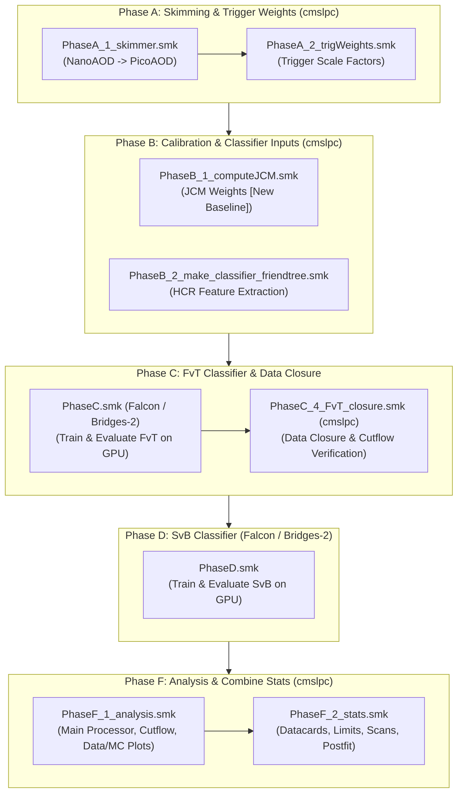
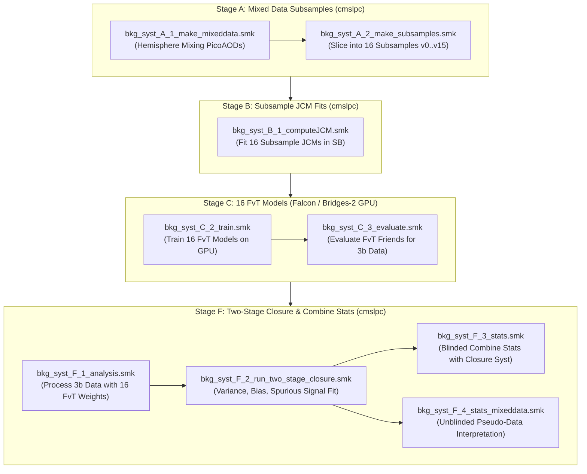
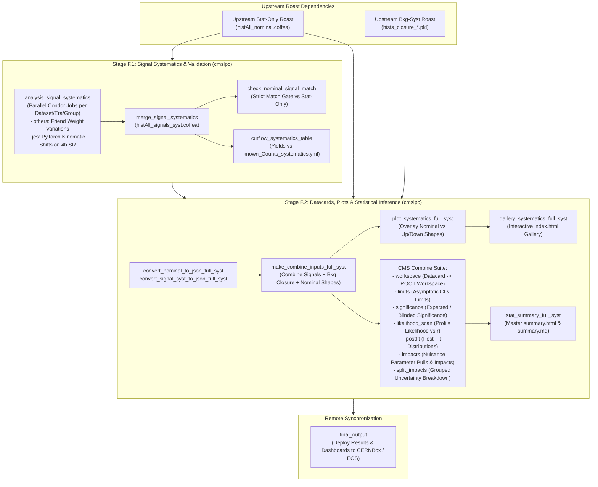

# Coffea4bees Analysis Workflows

This document describes the Snakemake workflows orchestrated for the **HH $\to$ 4b** and **ttH(bb)** analyses in `coffea4bees`.

The analysis framework organizes production into three primary workflow architectures:
1. **[Stat-Only (Nominal) Pipeline](#1-stat-only-nominal-pipeline)**: End-to-end baseline analysis from picoAOD skimming to statistical limits without systematic shape uncertainties.
2. **[Background Systematics Pipeline (`bkg_syst`)](#2-background-systematics-pipeline-bkg_syst)**: Multi-sample mixed-data closure, 16 independent JCM calibrations, 16 FvT models trained on GPUs, two-stage background closure, and Combine statistical inference.
3. **[Full Systematics Pipeline (`full_syst`)](#3-full-systematics-pipeline-full_syst)**: Integrates signal systematic variations (`others` friend weights, `jes` PyTorch kinematic shifts) with data-driven background closure models from `bkg_syst`, performs nominal integrity gates, cutflow count validation, systematic variation plotting with interactive HTML galleries, and full CMS Combine statistical interpretation (limits, significance, likelihood scans, postfit, and impacts).

---

## Architecture Overview & Target Environments

Workflows execute across heterogeneous computing clusters according to workload requirements:

| Workflow | Stage | Target Machine | Compute Environment | Description |
| :--- | :--- | :--- | :--- | :--- |
| **Stat-Only** | **Phase A** | **`cmslpc`** | CPU (Condor / Dask) | NanoAOD $\to$ PicoAOD Skimmer & Trigger Weights |
| | **Phase B** | **`cmslpc`** | CPU (Condor / Dask) | JCM Calibration (B.1) & Classifier Friend Trees (B.2) |
| | **Phase C** | **`falcon`** / **Bridges-2** | GPU (CUDA / PyTorch) | FvT Classifier Training & EOS Friend Tree Evaluation |
| | **Phase C.4** | **`cmslpc`** | CPU (Condor / Dask) | FvT Data Closure & Validation Plots |
| | **Phase D** | **`falcon`** / **Bridges-2** | GPU (CUDA / PyTorch) | SvB Classifier Training & EOS Friend Tree Evaluation |
| | **Phase F** | **`cmslpc`** | CPU + Combine | Analysis Processor (F.1) & Combine Statistical Fits (F.2) |
| **Bkg Syst** | **Stage A** | **`cmslpc`** | CPU (Condor / Dask) | Slicing Mixed Data into 16 Subsamples ($v_0 \dots v_{15}$) |
| | **Stage B** | **`cmslpc`** | CPU (Condor / Dask) | Subsample JCM Calibrations ($v_0 \dots v_{15}$) |
| | **Stage C** | **`falcon`** / **Bridges-2** | GPU (CUDA / PyTorch) | Training 16 FvT Models & Friend Tree Generation |
| | **Stage C.4** | **`cmslpc`** | CPU (Condor / Dask) | Subsample FvT Closure Verification |
| | **Stage F** | **`cmslpc`** | CPU + Combine | Two-Stage Closure Fit (F.2) & Combine Datacards (F.3 / F.4) |
| **Full Syst** | **Stage F.1** | **`cmslpc`** | CPU (Condor / Dask) | Signal Systematics (`others` + `jes`), Merging, Integrity Gates |
| | **Stage F.2** | **`cmslpc`** | CPU + Combine | Datacards, Shape Variation Plots, Gallery & Impacts |

---

## 1. Stat-Only (Nominal) Pipeline

The Stat-Only pipeline establishes the nominal baseline event selection, data-driven background estimation (via single nominal FvT), signal-vs-background discrimination (via nominal SvB), and computes asymptotic limits assuming statistical uncertainties only.



### Key Phases:
- **Phase A (`Snakefile_PhaseA.smk`)**: Filters nanoAOD to compact picoAOD ntuples (`PhaseA_1_skimmer.smk`) and calculates trigger efficiency scale factors (`PhaseA_2_trigWeights.smk`).
- **Phase B (`Snakefile_PhaseB.smk`)**: Calibrates the Jet Combinatoric Model in the Sideband (`PhaseB_1_computeJCM.smk`) and extracts multi-jet kinematic features into friend trees (`PhaseB_2_make_classifier_friendtree.smk`).
- **Phase C (`Snakefile_PhaseC.smk` & `Snakefile_PhaseC_4_FvT_closure.smk`)**:
  - `C`: Multi-fold training and dataset evaluation of the Four-vs-Three (FvT) reweighting classifier on GPUs.
  - `C4`: Mandated data closure step on `cmslpc` running Coffea over collision data and $t\bar{t}$ MC to verify Sideband closure before touching the Signal Region.
- **Phase D (`Snakefile_PhaseD.smk`)**: Trains and evaluates the Signal-vs-Background (SvB) classifier across all datasets.
- **Phase F (`Snakefile_PhaseF.smk`)**:
  - `F.1` (`PhaseF_1_analysis.smk`): Runs `processor_HH4b.py` or `processor_ttHbb.py`, verifies cutflows against `known_Counts_<channel>.yml`, cross-checks against Phase C.4, and generates data/MC comparison plots.
  - `F.2` (`PhaseF_2_stats.smk`): Converts histograms to JSON, generates stat-only Combine datacards, builds workspaces, and computes expected limits, signal significance, and profile likelihood scans.

### Execution:
```bash
# Production execution via roast (recommended):
bin/roast new --config coffea4bees/workflows/config/nominal_run2.yml --phases B,C,C4,D,F --label nominal_run2
bin/roast checkout <id> --host cmslpc
bin/roast checkout <id> --host falcon
bin/roast submit <id> --step B
bin/roast submit <id> --step C     # on falcon GPU
bin/roast submit <id> --step C4    # on cmslpc CPU
bin/roast submit <id> --step D     # on falcon GPU
bin/roast submit <id> --step F     # on cmslpc CPU

# Direct local / dry-run execution:
./run_container snakemake -s coffea4bees/workflows/Snakefile_PhaseF.smk \
    --configfile coffea4bees/workflows/config/nominal_run2.yml -n
```

---

## 2. Background Systematics Pipeline (`bkg_syst`)

The Background Systematics workflow derives data-driven multijet background shape and normalization uncertainties by dividing mixed collision data into independent subsamples, training 16 distinct FvT neural network models, and performing a rigorous Two-Stage Closure test to extract non-closure variance, transfer bias, and spurious signal systematics.



### Key Stages:
- **Stage A (`Snakefile_bkg_syst_A_*.smk` / `Snakefile_bkg_syst_AB.smk`)**: Slices inclusive mixed data into 16 statistically independent subsamples ($v_0 \dots v_{15}$) and generates corresponding $t\bar{t}$ MC pseudo-data.
- **Stage B (`Snakefile_bkg_syst_B_1_computeJCM.smk`)**: Derives 16 independent JCM transfer functions by fitting each subsample in the Sideband.
- **Stage C (`Snakefile_bkg_syst_C.smk`)**:
  - `C`: Trains 16 independent FvT models on GPUs (Falcon / Bridges-2) using each subsample's classifier inputs.
  - `C.3`: Evaluates the 16 trained models on 3-tag collision data to produce 16 FvT friend tree reweightings.
  - `C.4`: Executes multi-subsample closure validation on `cmslpc`.
- **Stage F (`Snakefile_bkg_syst_F.smk`)**:
  - `F.1`: Processes 3-tag collision data with the 16 FvT weight variations through the Coffea analysis processor.
  - `F.2`: Runs `runTwoStageClosure.py` across multiple rebin configurations (e.g. rebin 1, 6, 12, 24), evaluating non-closure variance, model bias, and extracting the canonical closure systematic pickle file (`hists_closure_*.pkl`).
  - `F.3`: Constructs Combine datacards incorporating the background closure systematics (`--bkg_syst_file`) and computes blinded expected limits, significance, and likelihood scans.
  - `F.4`: Performs unblinded statistical interpretation using the 16-subsample average mixed data $\langle\text{mix}\rangle_{4b}$ as pseudo-data.

### Execution:
```bash
# Production execution via roast:
bin/roast new --config coffea4bees/workflows/config/ttHbb_bkg_syst.yml --phases BKG_C,BKG_F --label ttHbb_bkg_syst
bin/roast checkout <id> --host cmslpc
bin/roast checkout <id> --host falcon
bin/roast submit <id> --step BKG_C     # GPU training & evaluation
bin/roast submit <id> --step BKG_C4    # CPU closure
bin/roast submit <id> --step BKG_F     # CPU two-stage closure & Combine stats
```

---

## 3. Full Systematics Pipeline (`full_syst`)

The Full Systematics workflow represents the final production analysis step. It integrates signal systematic variations with the data-driven background closure models derived in `bkg_syst`, performs rigorous quality gates, plots all shape variations, compiles an interactive HTML gallery, and executes the complete CMS Combine statistical inference suite.



### Key Stages & Quality Gates:

#### Stage F.1: Signal Systematic Processing & Verification (`Snakefile_full_syst_1_analysis.smk`)
1. **Parallel Singlefile Generation (`analysis_signal_systematics`)**:
   Executes Coffea processors partitioned by `(dataset, year, syst_group)`:
   - `others`: Friend-tree weight variations (pileup, b-tagging SFs, PDF, renormalization/factorization scales, trigger efficiencies).
   - `jes`: Jet energy scale and resolution kinematic shifts evaluated through dedicated PyTorch classifier models on 4b Signal Region events.
2. **Merging (`merge_signal_systematics`)**:
   Combines all singlefile outputs into a single consolidated file: `histAll_<label>_signals_syst.coffea`.
3. **Nominal Distribution Match Gate (`check_nominal_signal_match`)**:
   Compares the nominal signal distribution in the full systematics run against the upstream stat-only baseline across all variables, regions (SR, SB), and 4-tag selections. **If any discrepancy exceeds tolerance ($10^{-4}$), the workflow halts immediately.**
4. **Systematic Cutflow Validation (`cutflow_systematics_table`)**:
   Extracts Signal Region yields for every nominal, up, and down systematic variation, compares them against canonical counts in `known_Counts_systematics_<sig>.yml`, and outputs HTML, YAML, and TXT cutflow reports.

#### Stage F.2: Datacards, Plots, Gallery & Statistical Inference (`Snakefile_full_syst_2_stats.smk`)
1. **JSON Serialization & Datacard Construction (`make_combine_inputs_full_syst`)**:
   Integrates nominal shapes (`histAll_nominal.json`), signal systematic variations (`histAll_signals_syst.json`), and the background closure model (`bkg_syst_file`). Automatically synchronizes histogram rebinning with the background closure step (e.g. `rebin: 24` for ttHbb).
2. **Systematic Variations Visualization (`plot_systematics_full_syst`)**:
   Invokes `coffea4bees/plots/make_syst_plots.py` to generate overlaid shape comparison figures (Nominal vs. Up vs. Down) with ratio panels for every nuisance parameter.
3. **Interactive Systematic Gallery (`gallery_systematics_full_syst`)**:
   Invokes `src/plotting/make_gallery.py` to build an interactive HTML gallery (`index.html`) displaying all systematic variation plots.
4. **Complete Combine Statistical Inference**:
   - `workspace`: Compiles text datacard into Combine physics workspace.
   - `limits`: Computes asymptotic CLs upper limits on signal strength modifier $r$.
   - `significance`: Computes expected signal significance.
   - `likelihood_scan`: Scans profile likelihood across parameter $r$.
   - `postfit`: Extracts background-only and signal-plus-background post-fit distributions.
   - `impacts`: Performs full nuisance parameter fit suite (`impacts_initial_fit`, `impacts_do_fits`, `impacts_collect`) producing impact summary PDF.
   - `split_impacts`: Evaluates grouped uncertainty breakdowns (theory, experimental, background closure).
5. **Consolidated Summary (`stat_summary_full_syst`)**:
   Compiles all fit results, limits, scans, and galleries into `summary.html` and `summary.md`.
6. **Remote Deployment (`final_output`)**:
   Transfers all analysis and statistical artifacts to CERNBox/EOS and sends completion notifications.

### Configuration Format (`ttHbb_full_syst.yml`):
```yaml
base: coffea4bees/workflows/config/ttHbb.yml

label: "ttHbb_full_syst"
output_path: "output/ttHbb_full_syst/"
processor: "coffea4bees/analysis/processors/processor_ttHbb.py"

inputs:
  nominal_hists: "output/ttHbb_stat_only/PhaseF_1_analysis/histAll_ttHbb_stat_only.coffea"
  bkg_syst_file: "coffea4bees/stats_analysis/files/HIG-24-010/zz/hists_closure_3bDvTMix4bDvT_SvB_MA_ps_zz_rebin1.pkl"

signal_datasets:
  - "ttHbb"

syst_groups:
  - "others"
  - "jes"

rebin: 24

channels:
  ttHbb:
    signallabel: "ttHbb"
    variable: "SvB_MA.ps_ttHbb"
    signal: "ttHbb"
    region: "SR"
    cut: "sum"
    rebin: 24
    stat_only: false
    metadata: "coffea4bees/stats_analysis/metadata/ttHbb.yml"
    combine_flags: "--three_tag threeTag --four_tag fourTag --region SR --blind"
```

### Execution:
```bash
# Production execution via roast (recommended):
bin/roast new --config coffea4bees/workflows/config/ttHbb_full_syst.yml --phases FULL_SYST --label ttHbb_full_syst
bin/roast checkout <id> --host cmslpc
bin/roast submit <id> --step FULL_SYST -n    # dry-run DAG
bin/roast submit <id> --step FULL_SYST       # execute detached in tmux

# Run sub-stages standalone via Snakemake:
# Stage F.1 only:
./run_container snakemake -s coffea4bees/workflows/Snakefile_full_syst_1_analysis.smk \
    --configfile coffea4bees/workflows/config/ttHbb_full_syst.yml --cores 4

# Stage F.2 only:
./run_container snakemake -s coffea4bees/workflows/Snakefile_full_syst_2_stats.smk \
    --configfile coffea4bees/workflows/config/ttHbb_full_syst.yml --cores 4

# End-to-end master workflow:
./run_container snakemake -s coffea4bees/workflows/Snakefile_full_syst.smk \
    --configfile coffea4bees/workflows/config/ttHbb_full_syst.yml --cores 4
```

---

## 4. Summary Matrix of Analysis Workflows

| Feature / Capability | Stat-Only (Nominal) | Background Systematics (`bkg_syst`) | Full Systematics (`full_syst`) |
| :--- | :--- | :--- | :--- |
| **Primary Goal** | Baseline event selection & initial limit | Multijet background closure & transfer systematic | Final physics measurement with full systematics |
| **Master Snakefile** | `Snakefile_PhaseF.smk` | `Snakefile_bkg_syst.smk` | `Snakefile_full_syst.smk` |
| **Roast Phases** | `B, C, C4, D, F` | `BKG_C, BKG_F` (or `BKG_AB, BKG_C, BKG_F`) | `FULL_SYST` |
| **Input Signals** | Nominal signal MC | N/A (background and MC pseudo-data) | Signal MC (`others` weights + `jes` shifts) |
| **Background Estimation** | Inclusive nominal FvT | 16 FvT models on 16 mixed data subsamples | Upstream `hists_closure_*.pkl` from `bkg_syst` |
| **Quality Gates** | Cutflow agreement (`known_Counts`) | Closure $\chi^2$, bias, spurious signal tests | Nominal match gate ($10^{-4}$ tolerance) & systematic cutflow |
| **Combine Datacard** | Nominal shapes only (`stat_only: true`) | Closure systematic shapes (`bkgsyst`) | Signal variations + closure systematics + nominal shapes |
| **Impacts & Nuisances** | None (stat-only) | Nuisance parameter impacts on closure model | Full nuisance parameter impacts & grouped split impacts |
